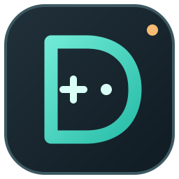

# ASSella Deck



Steam Deck focused fork of [ASSella](https://github.com/niwia/ASSella). The
improvements below are on this fork's `deck/beta` branch, which tracks upstream
`beta` through Git merges.

## Install on Steam Deck

In Desktop Mode, open Konsole and run this one command **after a verified beta
AppImage has been published**:

```bash
bash -c 'set -o pipefail; curl -fsSL https://raw.githubusercontent.com/tieorange/ASSella-Deck/deck/beta/install.sh | bash -s -- --install'
```

It installs **ASSella Deck** alongside ACCELA and ASSella, with its own AppImage
and launcher. It checks the fork release's SHA-256 before replacing any existing
ASSella Deck build. It never uses an upstream AppImage as a fallback. There is
currently **no published fork AppImage**, so the command reports that no beta
release is available and cannot yet install the app. For update, rollback,
uninstall, and shared Steam integration details, see the [Deck install guide](docs/install.md).

## Improvements in this fork

- **Recoverable library scans:** Missing Steam libraries, worker errors, and
  cancellation end the scanning state and leave the Scan Libraries button ready
  to retry. A second scan cannot start while one is running.
- **microSD recovery:** Games cached from an unavailable library remain visible.
  The library shows the missing path and rescans when the card is reconnected.
  Successful scans remove games that are no longer present on available drives.
- **Responsive large libraries:** Game rows render in batches, and artwork is
  requested for visible rows first. Scan time is logged per library and overall
  to support measurements on a Deck.
- **Fork-controlled updates:** The installer, in-app updater, and AppImage update
  metadata point to this fork. The installer fails clearly if this fork has no
  release instead of installing an upstream build.
- **Side-by-side installation:** The fork reserves its own AppImage, desktop
  entry, icon, settings, and data paths. Its installer, updater, and uninstaller
  leave ACCELA and upstream ASSella files alone. See the
  [Deck install guide](docs/install.md).
- **Deck navigation:** Home leads directly to Library, Find a Game, and Activity.
  Game Library has a visible scan action, storage recovery notice, and an Open
  Game Details action. Game Details uses a large vertical section rail.
- **Guided installs:** Search, build and depot selection, storage and backend,
  and review share one window. A package enters the queue only after the final
  Add to Queue action. Native controller mappings, keyboard focus, and Back
  behavior are wired across these screens; controller hardware verification is pending.
- **Activity and recovery:** The Activity screen shows current progress and
  queued games, with pause, cancel, remove, and retry actions backed by the
  existing task manager. The macOS UI mock can review Deck layouts safely.
- **Touch polish:** Shared 48px minimum actions, clearer focus and pressed
  states, artwork-led Library rows, a direct scan retry, readable install
  review, and larger onboarding and confirmation controls fit Deck layouts.
- **Upstream merge path:** The repository retains ASSella's Git history and has
  an [upstream merge guide](docs/deck-fork.md). Focused local tests cover scan
  recovery, large-library rendering, guided navigation, and queue recovery.

Steam Deck hardware timing, AppImage install and rollback, and binary
redistribution checks are still pending. No modified AppImage has been released.

Original ASSella installation guide: https://yeet.md/s/g6jhSh-M

Contributing with an AI coding agent? Start with [AGENTS.md](AGENTS.md) and the
[agent guide](docs/agent-guide.md).

Preview the safe UI mock with `python scripts/run_ui_mock.py --deck` or
`--deck-720`. Add `--state loading|empty|error|missing-sd|large` for Library
and Activity fixtures, or `--screen onboarding|confirmation` for those dialogs.
The mock uses in-memory data and never starts an install or Steam service.
